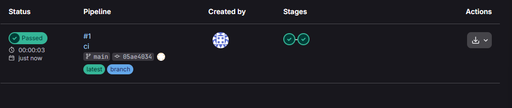

# Домашнее задание: GitLab CI

## .gitlab-ci.yml

```yaml
stages:
  - build
  - test

build-job:
  stage: build
  tags:
    - netology
  script:
    - echo "Building"
    - mkdir -p build
    - touch build/info.txt
  artifacts:
    paths:
      - build/

test-job:
  stage: test
  tags:
    - netology
  script:
    - echo "Testing"
    - test -f build/info.txt
```

Две стадии: `build` создаёт папку `build` с файлом `info.txt`, `test` проверяет, что файл на месте. Чтобы папка дошла до второй стадии, она передаётся как artifact. Оба задания идут на раннере с тегом `netology`.

## Скриншот успешного выполнения


